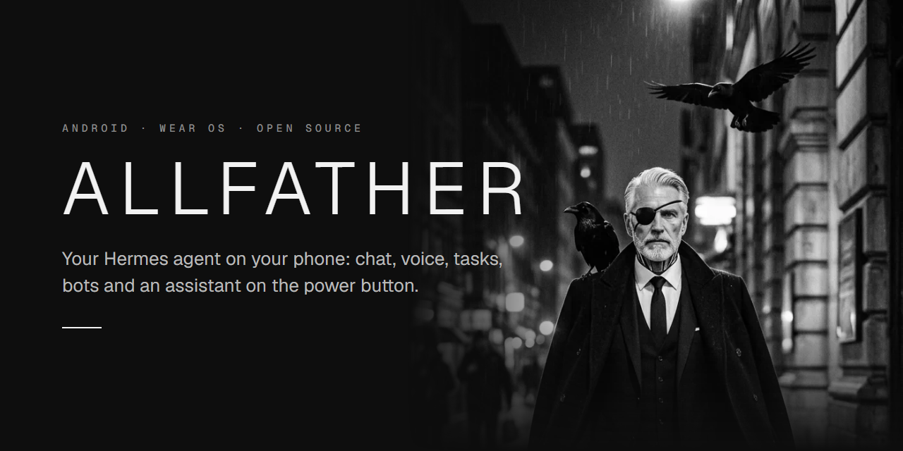
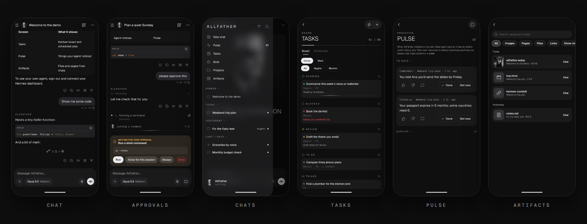

<p align="center">
  
</p>

<p align="center">
  <a href="https://github.com/JusticeFist/alfatherapp/releases/latest"></a>
  
  
  
  <a href="LICENSE"></a>
</p>

<p align="center">
  A native Android client for <a href="https://github.com/NousResearch/hermes-agent">Hermes Agent</a>, with a Wear OS companion.<br>
  It signs in to <b>your own</b> Hermes dashboard and puts your agent on your phone.
</p>

<p align="center">
  <a href="https://github.com/JusticeFist/alfatherapp/releases/latest"><b>Download the APK</b></a> ·
  <a href="#what-you-need">What you need</a> ·
  <a href="#build">Build</a> ·
  <a href="#español">Español</a>
</p>

<p align="center">
  
</p>

## Features

| | |
|---|---|
| **Chat** | Streaming replies with Markdown, code, LaTeX, Mermaid, images and files. Model and reasoning picker; queue, steer or interrupt a running turn; reactions, read aloud, quote, fork. |
| **Approvals** | Approve or deny your agent's commands right in the chat, or from the notification. |
| **Chats, Projects, Artifacts** | Pins, archive, sources and search; every file, page and link your agent made, in one place. |
| **Tasks** | The Kanban board and scheduled (cron) jobs, with each run's result. |
| **Bots** | Profiles and group rooms; helper profiles your agent can consult ("Ask your helpers"). |
| **Pulse** | Your agent's proactive cards: what it noticed on its own, rated by you. |
| **Voice** | Dictation, read aloud, Gemini Live calls and a wake phrase. |
| **Assistant** | Hold the power button. Phone control through an accessibility service asks before sending, paying or deleting, and never touches passwords, banking or password-manager apps. |
| **Notifications** | FCM, end-to-end encrypted: replies, approvals, calls and live progress. |
| **Sharing** | Opt-in and end-to-end encrypted: calendar, phone state, location, Health Connect. |
| **Wear OS** | Ask by voice and hear the answer; tile and complication. |
| **Everywhere** | Share target, launcher shortcuts, home-screen widget, Quick Settings tile. English and Spanish UI. |

## Install
Download `AllFather.apk` (and `AllFatherWatch.apk` for the watch) from the
[latest release](https://github.com/JusticeFist/alfatherapp/releases/latest) and open it on your phone. Android asks
once to allow installs from your browser or file manager. The phone and watch APKs share one signing key, so take
both from the same release.

## What you need
- A Hermes host running the web dashboard (`hermes dashboard`, port 9119 by default) that your phone can reach
  (LAN, Tailscale, or a tunnel; Cloudflare Access service tokens are supported).
- The host plugin `conduit_push` (notifications, calls, Pulse, sharing, artifacts…):
  ```bash
  hermes plugins install kaishi00/hermes-conduit-notifier --enable
  ```
  then restart the dashboard. The app can update it later from Settings.
- Android 10 (API 29) or newer. Wear OS watch optional.

## Build
JDK 17 or newer and the Android SDK (`ANDROID_HOME`, or `sdk.dir` in `local.properties`).
```bash
./gradlew testDebugUnitTest :app:assembleRelease :wear:assembleRelease
```
APKs land in `app/build/outputs/apk/release/` and `wear/build/outputs/apk/release/`. Release builds are signed
with your debug key: install the phone and watch APKs from the same machine (they must share the signing key).
```bash
adb install -r app/build/outputs/apk/release/app-release.apk
```
Then open the app, enter your dashboard address, username and password (or tap "Ask Hermes" for a prompt that
makes Hermes set it up and send you a sign-in link).

## Push notifications (optional)
Without this the app works, just without notifications.
1. Create a Firebase project, add an Android app with package `app.allfather`, download `google-services.json`
   into `app/`, and rebuild.
2. In Firebase: Project settings > Service accounts > Generate new private key.
3. Run the relay on your Hermes host (Docker, Node 22): see [`relay/`](relay/README.md).
4. In the app: Settings > Notifications (the relay URL defaults to `http://<dashboard host>:8787`).

## Host skills (recommended)
Copy the folders in [`host/skills/`](host/skills) into `~/.hermes/skills/` on your Hermes host:
- `allfather-app`: tells your agent how the app shows its replies and what the phone shares.
- `android-phone-control`: how to drive the phone with the app's `actions` block.
- `helper-team`: how to set up and consult helper profiles.

## Docs
- [`docs/protocol.md`](docs/protocol.md): the dashboard protocol the app speaks (REST + JSON-RPC WebSocket).
- [`docs/design-allfather.md`](docs/design-allfather.md): the design system.
- [`CONTRIBUTING.md`](CONTRIBUTING.md): build notes and library gotchas.

## Credits
- Fonts: [Geist](https://vercel.com/font) (SIL OFL). Icons: [Lucide](https://lucide.dev) (ISC).
- Bundled: [KaTeX](https://katex.org) and [Mermaid](https://mermaid.js.org) (MIT).
- Phone-control ideas from [buddy-android](https://github.com/ghorbelhamdi/buddy-android) (Apache-2.0).
- Licenses ship inside the app under `assets/licenses/` and `assets/web/`.

## License
[MIT](LICENSE).

---

## Español

AllFather es un cliente nativo de Android (y Wear OS) para [Hermes Agent](https://github.com/NousResearch/hermes-agent):
se conecta a tu propio dashboard de Hermes y trae a tu agente al teléfono, con chat, voz, notificaciones, tareas,
bots y un asistente en el botón de encendido. La interfaz está en inglés y español (sigue el idioma del teléfono).

**Instalar:** descarga `AllFather.apk` (y `AllFatherWatch.apk` para el reloj) de la
[última versión](https://github.com/JusticeFist/alfatherapp/releases/latest) y ábrelo en el teléfono.

**Necesitas** un host de Hermes con el dashboard (`hermes dashboard`, puerto 9119) accesible desde el teléfono, y
el plugin del host:
```bash
hermes plugins install kaishi00/hermes-conduit-notifier --enable
```

**Compilar** (JDK 17+ y Android SDK):
```bash
./gradlew testDebugUnitTest :app:assembleRelease :wear:assembleRelease
```

**Notificaciones (opcional):** crea un proyecto de Firebase con el paquete `app.allfather`, pon
`google-services.json` en `app/`, recompila y levanta el relay de [`relay/`](relay/README.md) en tu host.

**Skills del host:** copia las carpetas de [`host/skills/`](host/skills) a `~/.hermes/skills/`.
